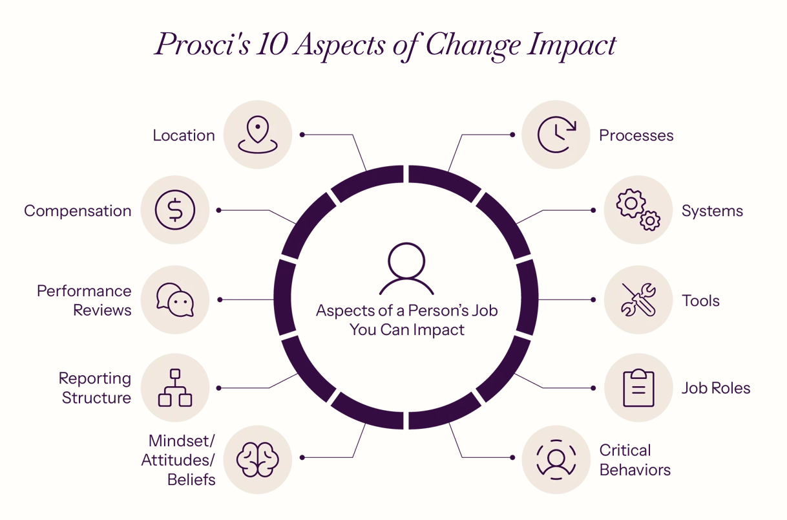

# O que vamos ver... {background-color="#105666"}

## Tópicos

1. Impactos
2. Áreas do Conhecimento
3. Lógica de Transformação
4. Planejamento e Execução
5. Revisão e Referências

# Impactos {background-color="#D3968C"}

## Contexto
### Considere o seguinte contexto de mudança organizacional:
- A empresa na qual você trabalha decidiu modificar os processos de Supply Chain, de forma a adequá-los às novas realidades da empresa, que envolvem:
  - Atender clientes e mercados globais;
  - Desenvolver uma rede de fornecedores estratégicos;
  - Desenvolver soluções customizadas para clientes prioritários.
- Será implantando um novo sistema de software com tecnologias de *Machine Learning* (ML) e Inteligência Artificial (IA).
  - O objetivo é criar agilidade para priorização e viabilizar uma política de preço que acompanha as variações do mercado.

## Mapeamento de Impactos
### A partir do contexto descrito, liste os impactos que você consegue identificar:

::: {.fragment}
1. Novas [formas de lidar com clientes.]{.fg style="--col: #D3968C"}
:::
::: {.fragment}
2. Novas [formas de lidar com fornecedores.]{.fg style="--col:  #839958"}
:::
::: {.fragment}
3. Nova política de preços mais dinâmica.
:::
::: {.fragment}
4. Aprender a usar o novo software.
:::
::: {.fragment}
5. Mudança de [paradigma]{.fg style="--col: #D3968C"} - uso de ML e IA.
:::
::: {.fragment}
6. Mudança na [estrutura]{.fg style="--col: #839958"} da equipe.
:::

## Diferentes **Tipos** de Impactos
### Como você classificaria os impactos do slide anterior nas seguintes categorias?

::: {.fragment}

:::

## Desafios sobre Mapeamento de Impactos
<p/>
:::{.box-list}
:::{.box}
1. Só existe uma classificação de impactos? Qual a vantagem de se utilizar uma classificação de impactos?
:::
:::{.box}
2. Impactos podem ocorrer distantes no tempo?
:::
:::{.box}
3. Uma mudança só gera um impacto? Uma mesma mudança pode gerar impactos diferentes em diferentes pessoas?
:::
:::{.box}
4. As pessoas são resistentes às mudanças, aos impactos, ou a forma como a mudança será conduzida (ou todos)?
:::
:::

# Áreas do Conhecimento {background-color="#839958"}

## Ações de Gestão de Mudanças

### Selecione as 3 ações mais importantes da lista abaixo:

:::{.box-grid}
::: {.box}
1. Pedir ao CEO para enviar memorando a toda a empresa comunicando a mudança.
:::
::: {.box}
2. Mudar a disposição física - salas e mesas - dos envolvidos.
:::
::: {.box}
3. Desenhar um sistema de bonificação para premiar o engajamento.
:::
::: {.box}
4. Analisar quem perderá, e o que será perdido, com a nova solução.
:::
::: {.box}
5. Divulgar a causa e o contexto de negócio que levou a empresa a buscar a nova solução.
:::
::: {.box}
6. Replanejar as metas individuais de performance.
:::
::: {.box}
7. Distribuir um adesivo com logo do projeto e mensagem de comprometimento com a mudança.
:::
::: {.box}
8. Colocar os melhores recursos em uma equipe para que todos tenham ela como exemplo.
:::
::: {.box}
9. Conversar individualmente com membros da equipe para identificar desafios com a mudança.
:::
:::

## Tipos de Atividades
### Classifique as atividades do slide anterior conforme as seguintes categorias...
<p/>
:::{.box-row}
::: {.box}
A. Comunicação
:::
::: {.box}
B. Estrutura
:::
::: {.box}
C. Política
:::
::: {.box}
D. Gestão de Pessoas
:::
:::
:::{.box-row}
::: {.box}
.<p/>.<p/>.<p/>.<p/>.<p/>
:::
::: {.box}
.<p/>.<p/>.<p/>.<p/>.<p/>
:::
::: {.box}
.<p/>.<p/>.<p/>.<p/>.<p/>
:::
::: {.box}
.<p/>.<p/>.<p/>.<p/>.<p/>
:::
:::


## {background-image="img/kanagawa.jpg"}

::: {.message-box}

People don't resist change.

They resist uncertainty.

:::

## Alerts & Cross-refs {#sec-crossref}

To emphasize specific words or text, you can:

- Use the default `.alert` class, e.g. [important note]{.alert}.
- Use the `.fg` class for custom colour, e.g. [important note]{.fg style="--col: #e64173"}.
- Use the `.bg` class for custom background, e.g. [important note]{.bg style="--col: #e64173"}.

To cross-reference, you have several options, for example:

- Beamer-like `.button` class provided by this theme, e.g. [[Appendix]{.button}](#sec-appendix)
- Quarto's native cross-ref syntax, e.g., "See @sec-appendix."

## Components

### Citations

Citations follow the standard
[Quarto format](https://quarto.org/docs/authoring/footnotes-and-citations.html#citations)
and be sourced from BibLaTex, BibTeX, or CLS files. For example:

 - [Topic 1:]{.alert} Spatial Frictions [@Fajgelbaum_Morales_Serrato_Zidar_2018; @Hsieh_Moretti_2019; @Moretti_2011]

- [Topic 2:]{.alert} Blah [@Suárez_Serrato_Zidar_2016]


## Components

### Multicolumn II: Text and figures

:::: {.columns}

::: {.column width="50%"}

:::

::: {.column width="50%"}

- A point about the figure that is potentially important.
- Another point about the figure that is also potentially important.
:::

::::

Note that sub- and multi-panel figures are also natively supported by Quarto.
See [here](https://quarto.org/docs/authoring/figures.html#subfigures).

## Components

### Multicolumn III: Code and output

```{r}
#| echo: true
#| label: fig-pairs
#| fig-cap: "Pairwise scatterplot" 
#| fig-asp: 1
#| output-location: column

palette("Classic Tableau")

par(
  family = "HersheySans",
  las = 1, pch = 19, cex = 1.5
)

pairs(
  iris[,1:4],
  col=iris$Species
)
```


# Figures {background-color="#40666e"}

## Figures
### Automatic scaling

We've already seen examples of code-generated plots and mulicolumn figures. But a reminder that figures will auto-scale with the available space.


## Figures
### Backround images

You can use the `{.background-image}` container environment to completely fill
the slide background with an image.

Ideally, your figure will be the same aspect ratio as the screen that you're presenting on.

- This can be a bit tricky because of the dynamic nature of reveal.js / HTML. But it's probably something close to 16:9.
- Aspect ratio can also matter for a regular full-frame images (previous slide).

## {background-image="img/kanagawa169.jpg" background-size="100%"}


# Other {background-color="#40666e"}

## Other

### What else can the clean theme do?

We have highlighted some theme-specific components in this demo.

But please note that all of the standard
[reveal.js functionality and plugins](https://quarto.org/docs/presentations/revealjs/presenting.html)
are compatible with the clean theme. This includes:

- [chalkboard](https://quarto.org/docs/presentations/revealjs/presenting.html#chalkboard) for annotating slides.
- [multiplex](https://quarto.org/docs/presentations/revealjs/presenting.html#multiplex) for enabling audience navigation of your slides.
- [pdf printing](https://quarto.org/docs/presentations/revealjs/presenting.html#print-to-pdf) in case you don't have access to a web browser.
- Etc.

# Summary {background-color="#40666e"}

## Summary


## References

::: {#refs}
:::

## Appendix {#sec-appendix}

```{r}
#| cache: true
#| label: tbl-attsum
#| tbl-cap: Summary of the base R `attitude` dataset

library(modelsummary)
datasummary_skim(attitude)
```

[[Back to main]{.button}](#sec-crossref)
